# koptup Comercio Electrónico

**Plataforma SaaS multi-negocio para operar un comercio de punta a punta: pedidos (también desde un mensaje de WhatsApp o por voz, con IA), inventario, despachos, catálogo, proveedores y finanzas.** Una sola instalación atiende a varios negocios aislados entre sí.

[](https://koptup-comercio-electronico.vercel.app)
[](https://nextjs.org/)
[](https://react.dev/)
[](https://www.typescriptlang.org/)
[](https://supabase.com/)
[](https://platform.openai.com/)
[](#pruebas)

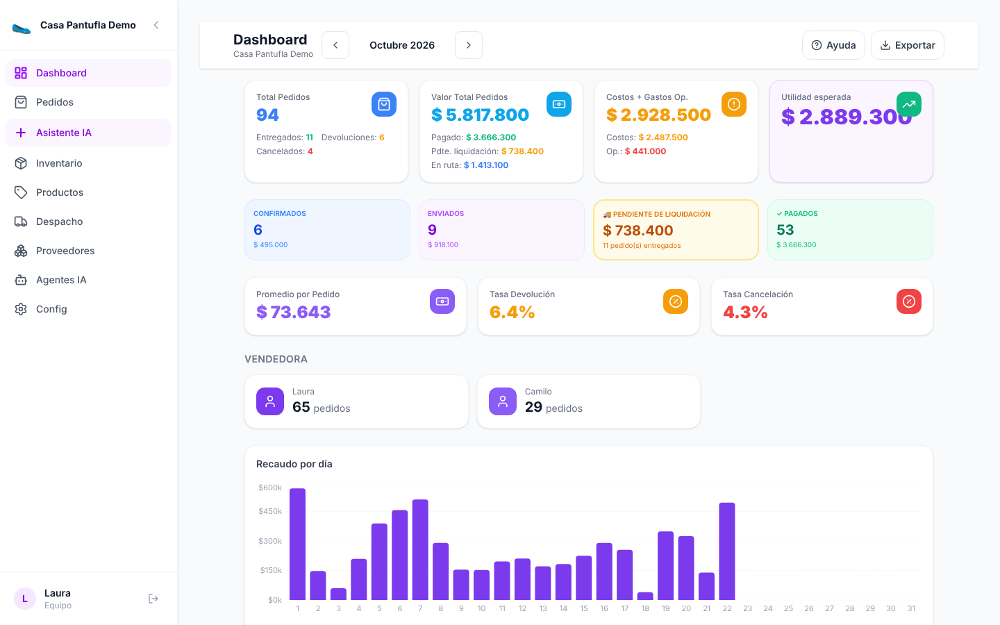

<sub>Dashboard mensual de un negocio de ejemplo. Todas las capturas usan datos ficticios (ver [cómo se tomaron](#sobre-las-capturas)).</sub>

**Sitio en producción:** <https://koptup-comercio-electronico.vercel.app> — abre en la pantalla de ingreso. Un negocio nuevo puede registrarse desde ahí y queda pendiente hasta que el administrador de la plataforma lo aprueba.

---

## Contenido

- [Qué es y para quién](#qué-es-y-para-quién)
- [Funcionalidades](#funcionalidades)
- [Capturas](#capturas)
- [Cómo funciona](#cómo-funciona)
- [Stack](#stack)
- [Correr en local](#correr-en-local)
- [Pruebas](#pruebas)
- [Despliegue](#despliegue)
- [Estado del proyecto](#estado-del-proyecto)
- [Documentación adicional](#documentación-adicional)
- [Autor](#autor)

---

## Qué es y para quién

koptup Comercio Electrónico está pensado para **pequeños y medianos negocios de Colombia que venden por WhatsApp y redes y despachan con mensajería**: tiendas que reciben los pedidos por chat y los anotan en hojas de cálculo (la app puede importar esos Excel).

La app cubre el ciclo completo de la operación:

**capturar el pedido → validarlo contra el stock → confirmarlo → alistarlo → despacharlo (guía y ruta) → entregarlo → cobrarlo → medir la utilidad.**

Dos ideas la definen:

1. **La IA trabaja, pero no decide sola.** El comerciante puede pegar el mensaje del cliente, dictarlo o conversar con el asistente. El servidor valida lo que entiende el modelo contra el catálogo y el inventario reales, **pregunta** cuando falta un dato o la variante no existe, y nada se escribe sin la confirmación de una persona.
2. **Multi-negocio de verdad.** Cada negocio (tenant) tiene su propia marca, categorías, módulos visibles, nombres de menú y especialización del asistente, y sus datos quedan aislados en la base de datos con `tenant_id` y políticas RLS de PostgreSQL.

---

## Funcionalidades

Todo lo que sigue está implementado en este repositorio. Entre paréntesis va el archivo principal, por si quieres revisarlo.

### Pedidos

- **Tres formas de crear un pedido:** formulario manual, **"Pedido IA"** (pegas el texto de WhatsApp o lo dictas por voz) y el asistente conversacional.
- **Aclaración en vez de suposición** ([`parseClarify.ts`](src/lib/orders/parseClarify.ts)): el servidor revisa los datos de despacho obligatorios (nombre, teléfono, dirección y valor) y cada variante (color, talla y la combinación de ambos) contra el inventario en stock. Si falta algo, responde con una pregunta concreta y las opciones disponibles, aunque el modelo haya dicho que el pedido estaba completo.
- **Fases del pedido** ([`phases.ts`](src/lib/orders/phases.ts)): Confirmado → En alistamiento → Alistado → Despachado → Entregado, más Pagado, Devolución y Cancelado. La base de datos rechaza cualquier otro estado.
- **Vistas:** calendario mensual con KPIs (pedidos, entregados, devoluciones, cancelados, recaudo y utilidad), vista de lista y **vista diaria** para editar en línea el estado, el tipo de envío y el vendedor.
- **Cobro:** contra entrega, anticipado, mixto u otro; el recaudo se registra como efectivo en caja, transferencia o pendiente de liquidar por el mensajero.
- **Código de pedido único por negocio**, con reintento automático si dos pedidos chocan ([`createOrderWithCode.ts`](src/lib/orders/createOrderWithCode.ts) y migración 013).
- **Recibo de alistamiento imprimible** con un QR que lleva al catálogo público del negocio ([`OrderReceipt.tsx`](src/components/orders/OrderReceipt.tsx)).

### Asistente IA (texto y voz)

- Chat que opera el negocio en lenguaje natural ([`/api/ai/assistant`](src/app/api/ai/assistant/route.ts)): crear pedidos, agregar o buscar inventario, consultar pedidos y catálogo, cambiar estados, registrar devoluciones, productos defectuosos, costos y gastos, crear o editar productos, ajustar o mover stock, revisar alertas, reimprimir guías y generar reportes en Excel.
- **Varias acciones en una frase:** "me llegaron 10 unidades a 20 mil" se convierte en ingreso de inventario más el gasto correspondiente.
- **Propone, no ejecuta:** el servidor devuelve acciones tipadas; las que modifican datos piden confirmación y las ejecuta el navegador con el cliente acotado al negocio. Borrar un producto exige escribir literalmente "Acepto".
- **Coincidencia estricta** ([`matching.ts`](src/lib/assistant/matching.ts)): si un nombre coincide con cero o con varios registros, el asistente pide precisión en vez de tocar la fila equivocada.
- Voz en español de Colombia con la Web Speech API del navegador, y un historial de "días de trabajo" del chat guardado en el propio navegador.
- El prompt se especializa por negocio (dominio, categorías, pistas de captura). La API key de OpenAI puede ser global (variable de entorno) o propia de cada negocio (se guarda en Configuración y se muestra enmascarada).
- Sin API key, "Pedido IA" responde con un mensaje claro y remite al formulario manual.

### Inventario

- Control por **canasta/ubicación física** y por variante (modelo, color, talla, cantidad, costo), con pestañas **Verificado / Defectuoso**, filtros, búsqueda y exportación a Excel.
- **Captura masiva desde texto** con IA ([`/api/ai/parse-inventory`](src/app/api/ai/parse-inventory/route.ts)) y foto por ítem.
- El proveedor se asigna al **ingresar la mercancía** (migración 018).
- Al guardar un pedido desde el formulario o desde el asistente se descuenta el stock ([`inventorySync.ts`](src/lib/inventorySync.ts)).

### Productos y catálogo público

- Catálogo con código, nombre, costo, precio de venta, categoría (propia de cada negocio), proveedor y foto.
- **"Con Foto IA"**: analiza la foto de un producto con `gpt-4o-mini` y sugiere sus datos ([`/api/ai/analyze-product`](src/app/api/ai/analyze-product/route.ts)).
- **Tope de productos según el plan**, aplicado por un trigger en la base de datos (migraciones 004, 005 y 008): al llegar al límite no se pueden agregar más, y los existentes nunca se borran.
- **Catálogo público por negocio** en `/catalog/<slug>` con la marca, foto y precio de los productos activos; el QR se descarga desde Configuración.

### Despacho y transportadora

- Selección de los pedidos confirmados de una fecha, **ruta sugerida agrupada por barrio** y **guías imprimibles** con la marca del negocio.
- **Transportadora por negocio** ([`src/lib/shipping/`](src/lib/shipping/)): el admin la elige en Administración; hay un adaptador para la API de Interrapidísimo y un modo *sandbox*. Al pasar un pedido a "Despachado" se crea la guía y se guarda el número de seguimiento; el webhook [`/api/shipping/webhook`](src/app/api/shipping/webhook/route.ts) (secreto comparado en tiempo constante y rate limit por IP) actualiza el tracking y puede marcar el pedido como entregado.
- Las credenciales de la transportadora se guardan **cifradas con AES-256-GCM** ([`crypto.ts`](src/lib/shipping/crypto.ts)).

### Proveedores

Módulo opcional por negocio ([`suppliers/page.tsx`](src/app/%28protected%29/suppliers/page.tsx), migración 016) para quien vende productos de varios proveedores:

- **Cierre por proveedor:** vendido, consumo a costo y utilidad bruta en un rango de fechas.
- **Cuentas por pagar** calculadas con el día de corte y el plazo de cada proveedor, con semáforo de vencimiento.
- **Rotación** por proveedor y un panel de consumo por día, semana o mes en el dashboard.
- El proveedor y el costo quedan **congelados en el pedido** al momento de la venta.

### Dashboard y finanzas

- KPIs del mes: pedidos, valor total, pagado, pendiente de liquidación, en ruta, costos y gastos operativos, utilidad esperada, ticket promedio y tasas de devolución y cancelación.
- Pedidos por vendedor, recaudo por día y por método de pago (Recharts), top 5 de productos y últimos pedidos.
- Gastos del negocio por categoría (se registran desde el asistente) y exportación a Excel con la marca del negocio.

### Agentes de análisis y alertas

Cinco agentes **basados en reglas** (deterministas y con pruebas, sin llamadas a un modelo) revisan los datos del negocio ([`src/lib/agents/`](src/lib/agents/)):

| Agente | Qué revisa |
|---|---|
| Auditor | Errores de negocio e inconsistencias |
| QA | Integridad de los datos (estados, fechas, rangos) |
| Inventario | Quiebres de stock, compras recomendadas y productos sin rotación |
| Financiero | Utilidad, margen y dinero pendiente de liquidar |
| Comercial | Productos estrella, productos sin ventas y combos |

El motor de automatizaciones ([`engine.ts`](src/lib/automations/engine.ts)) convierte los hallazgos en alertas accionables ("Generar orden de compra", "Revisar reposición"). Se ejecutan a demanda o con Vercel Cron.

### Multi-negocio, equipo y plataforma

- **Cuatro roles** ([`permissions.ts`](src/lib/permissions.ts)):

  | Rol | Alcance | Pantalla de inicio |
  |---|---|---|
  | `superadmin` | La plataforma: todos los negocios, sus usuarios, planes, cobros y métricas globales | Plataforma |
  | `admin` | Administra su negocio: equipo, invitaciones, auditoría, licencia y configuración. No opera pedidos ni inventario | Administración |
  | `member` | Opera el negocio: pedidos, asistente, inventario, productos, despacho, proveedores y agentes | Dashboard |
  | `viewer` | El negocio en modo lectura | Dashboard |

- **Módulos activables y renombrables por negocio** ([`modules.ts`](src/lib/modules.ts)); por ejemplo, un taller de motos ve "Ventas" y "Catálogo" donde otro ve "Pedidos" y "Productos".
- **Registro con aprobación** (migración 017): un negocio nuevo se registra y espera la aprobación del superadmin; un empleado se une con el enlace de invitación del negocio y espera la aprobación de su admin. Un cron borra los rechazados a los 30 días.
- **Auditoría** de las acciones sensibles (pagos, planes, usuarios, negocios).

### Planes y facturación

| Plan | Tope de productos | Precio mensual (COP) |
|---|---|---|
| Free | 50 | $0 |
| Pro | 500 | $49.900 |
| Enterprise | Ilimitado | $149.900 |

Hoy el superadmin asigna planes y registra pagos desde la pantalla Plataforma. El cobro en línea con Stripe está implementado (checkout y webhook idempotente, migración 015), pero mientras no se configuren sus llaves la pantalla "Mi licencia" lo muestra como **"En desarrollo"**.

### Importar y exportar

Importación de pedidos y datos desde Excel/CSV ([`/api/import`](src/app/api/import/route.ts)) y exportación a Excel de dashboard, pedidos, inventario y productos ([`/api/export`](src/app/api/export/route.ts)).

---

## Capturas

<table>
  <tr>
    <td width="50%">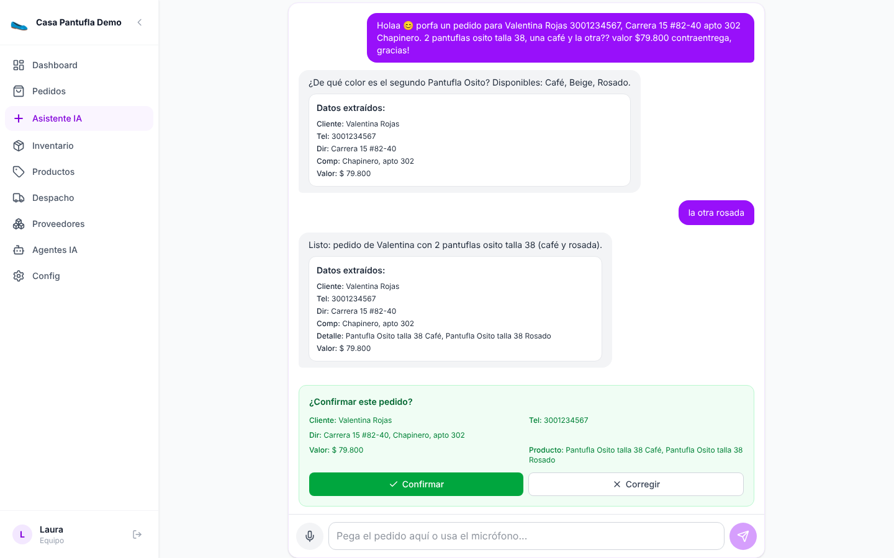<br><sub><b>Pedido IA.</b> Se pega el mensaje de WhatsApp; como falta el color de la segunda pantufla, el servidor pregunta con los colores que hay en stock y, con la respuesta, arma el pedido para confirmar.</sub></td>
    <td width="50%">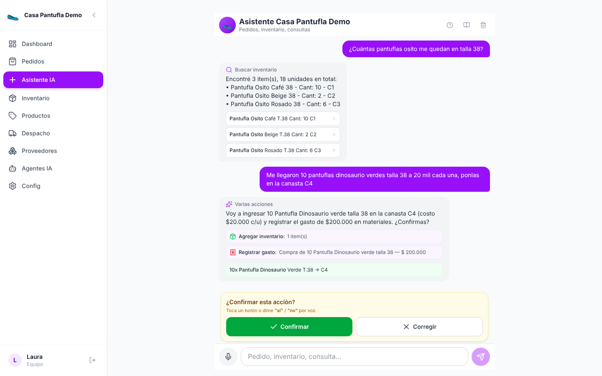<br><sub><b>Asistente IA.</b> Una consulta de inventario resuelta contra la base de datos y una frase que se convierte en dos acciones (ingreso de stock y gasto), que esperan confirmación.</sub></td>
  </tr>
  <tr>
    <td>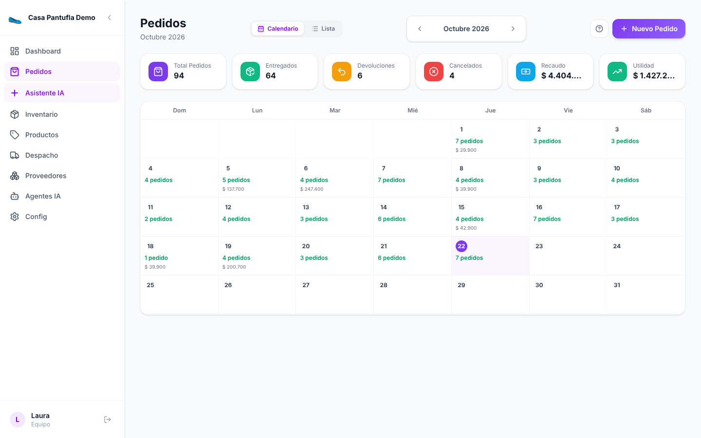<br><sub><b>Pedidos del mes</b> en calendario, con KPIs de recaudo y utilidad.</sub></td>
    <td>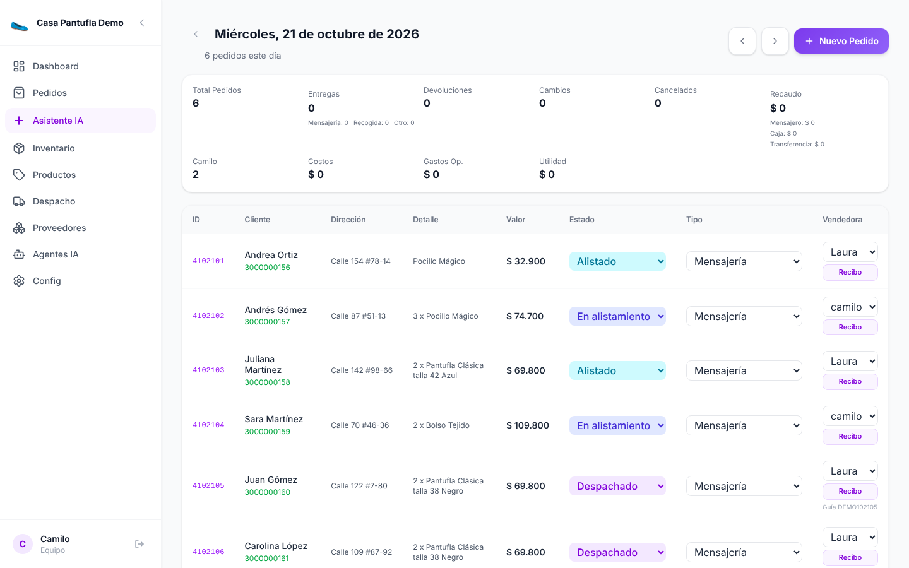<br><sub><b>Vista diaria</b> con las fases de alistamiento, el tipo de envío, el vendedor y el recibo de cada pedido.</sub></td>
  </tr>
  <tr>
    <td>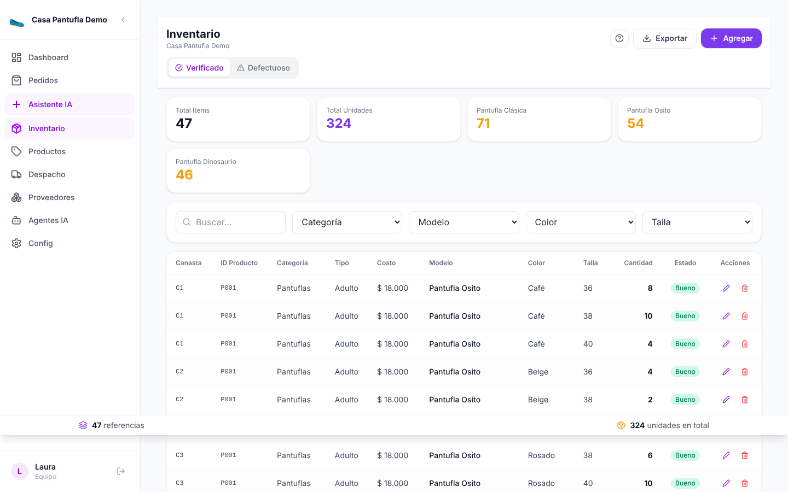<br><sub><b>Inventario</b> por canasta y variante (modelo, color, talla), con filtros y exportación.</sub></td>
    <td>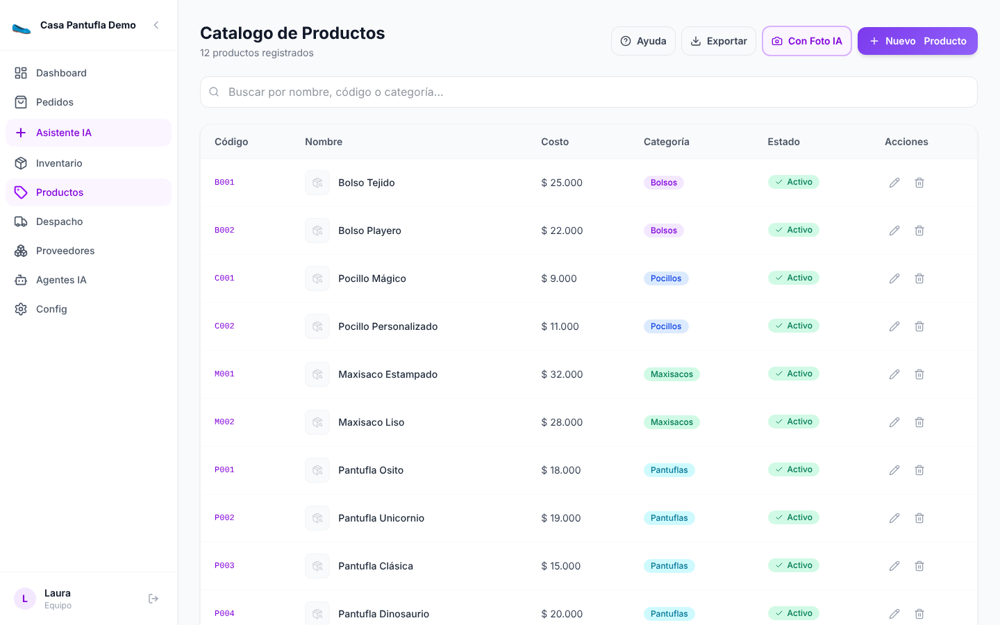<br><sub><b>Productos</b> con costo y categoría, y alta asistida por foto.</sub></td>
  </tr>
  <tr>
    <td>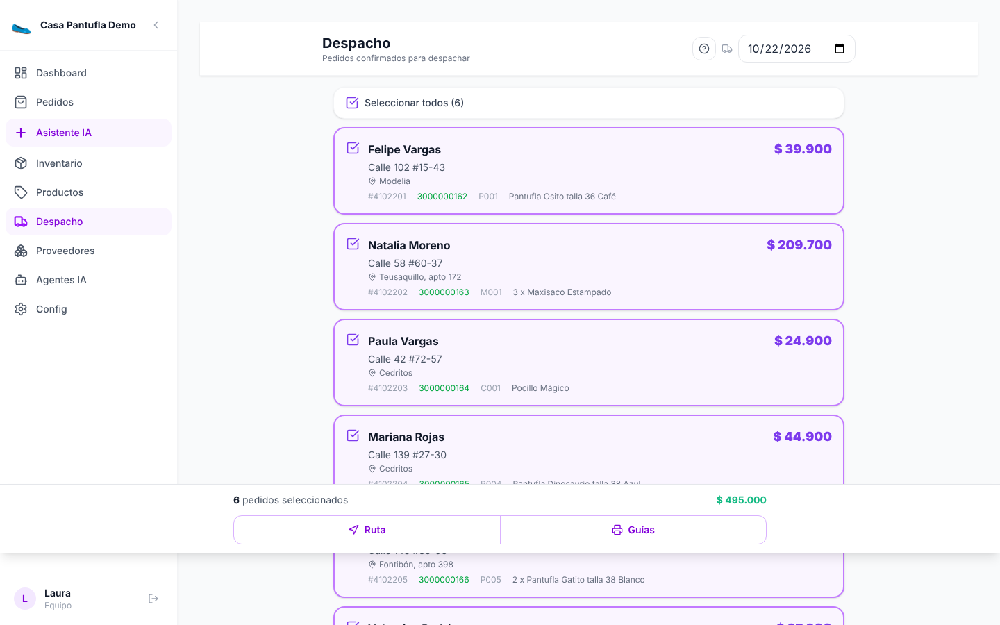<br><sub><b>Despacho:</b> los pedidos confirmados del día, listos para imprimir guías o la ruta por barrio.</sub></td>
    <td>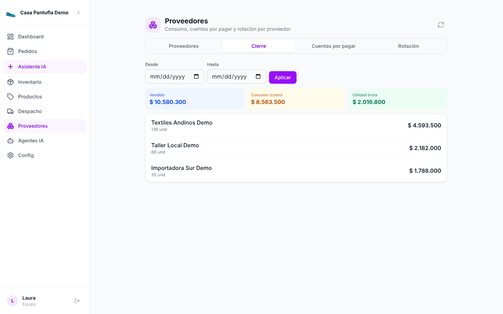<br><sub><b>Cierre por proveedor:</b> vendido, consumo a costo y utilidad bruta.</sub></td>
  </tr>
  <tr>
    <td>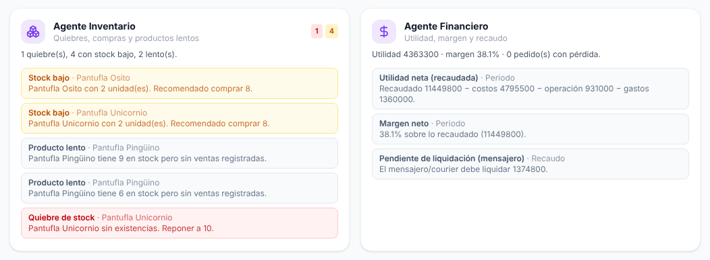<br><sub><b>Agentes</b> de inventario y financiero (fragmento de la pantalla Agentes IA).</sub></td>
    <td>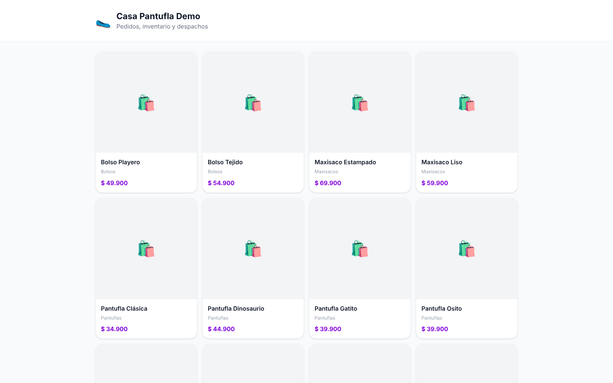<br><sub><b>Catálogo público</b> del negocio en <code>/catalog/&lt;slug&gt;</code>.</sub></td>
  </tr>
  <tr>
    <td>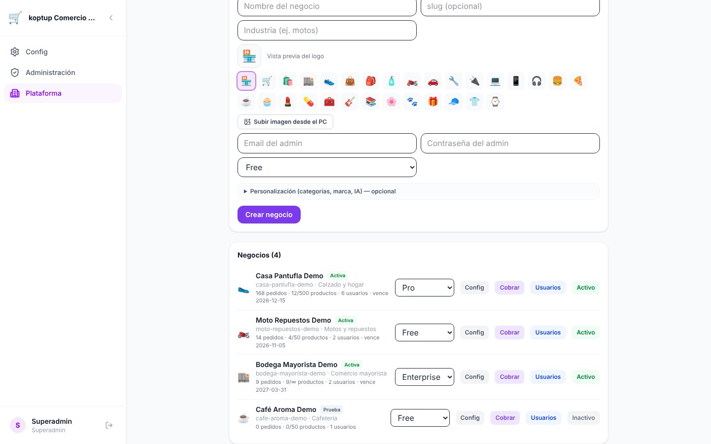<br><sub><b>Plataforma (superadmin):</b> alta de negocios, planes, cobros y una solicitud de registro pendiente.</sub></td>
    <td>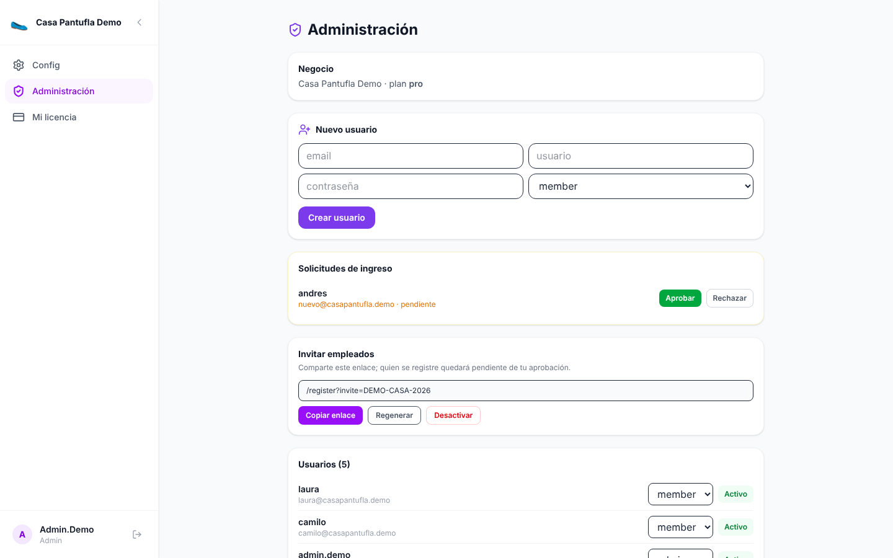<br><sub><b>Administración (admin):</b> usuarios, solicitudes de ingreso y enlace de invitación.</sub></td>
  </tr>
  <tr>
    <td>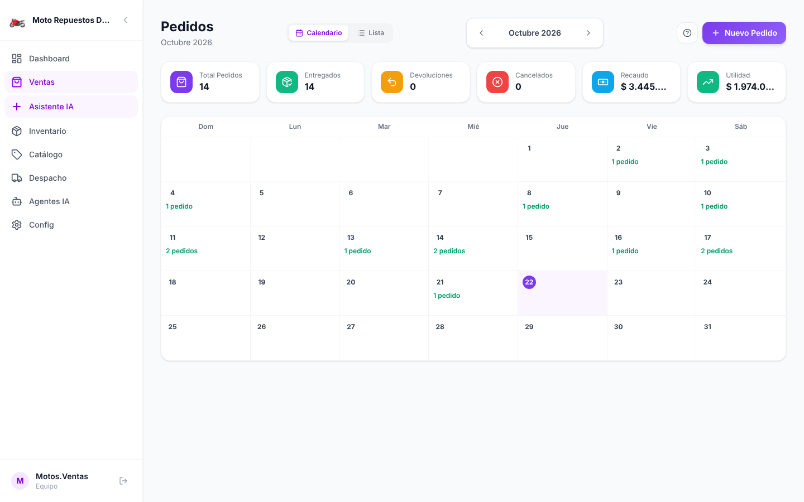<br><sub><b>Multi-negocio:</b> otro tenant con sus propios datos y menú ("Ventas", "Catálogo").</sub></td>
    <td>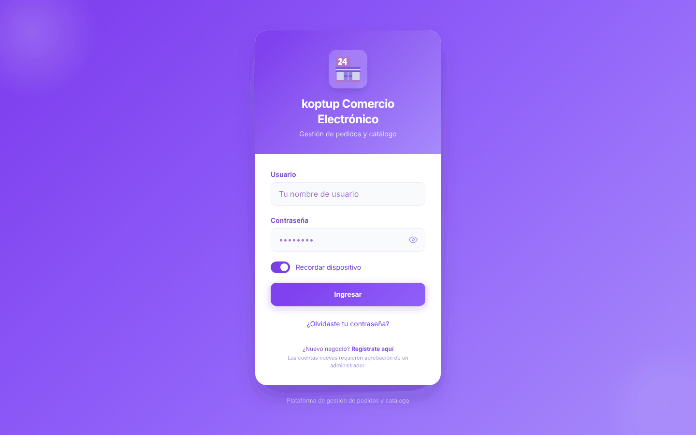<br><sub><b>Ingreso</b> (captura del sitio en producción).</sub></td>
  </tr>
</table>

**En el celular** (diseño *mobile-first* con barra inferior):

<p>
  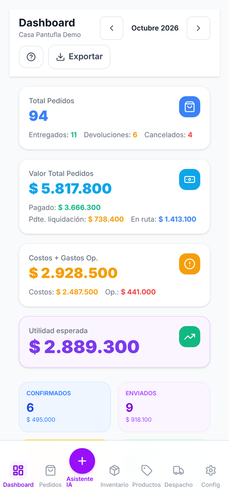
  &nbsp;&nbsp;
  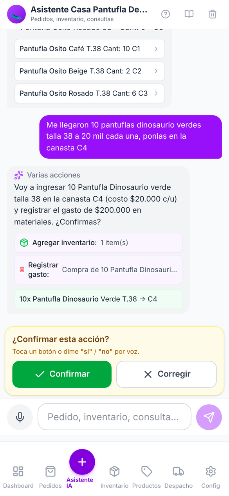
</p>

### Sobre las capturas

Salvo la pantalla de ingreso (tomada del sitio en producción), las capturas se tomaron con la app corriendo **en local** contra PostgreSQL 16 + PostgREST, después de aplicar `supabase-schema.sql` y todas las migraciones del repositorio, con **datos 100 % ficticios**: negocios inventados ("Casa Pantufla Demo", "Moto Repuestos Demo", etc.), clientes y teléfonos de ejemplo. Las respuestas del modelo de lenguaje vinieron de un *stub* local de la API de OpenAI; la validación contra inventario y las búsquedas las hizo el servidor real de la app. Ninguna captura contiene datos de clientes reales. En las del celular, el negocio de ejemplo tenía siete opciones de menú, y la captura de Agentes es un recorte de esa pantalla.

---

## Cómo funciona

### Arquitectura

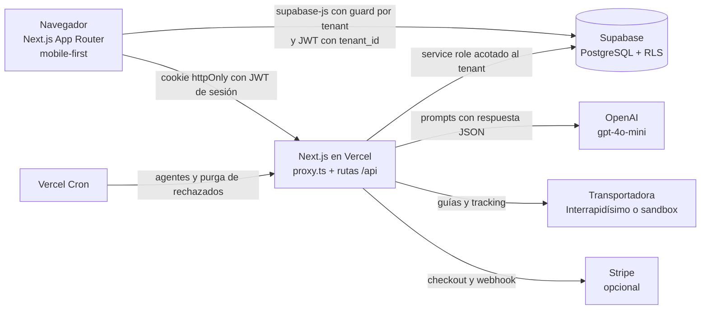

- **Frontend:** Next.js 16 (App Router) con React 19 y Tailwind CSS 4. Casi todas las pantallas son componentes cliente que leen y escriben en Supabase con `supabase-js`.
- **Servidor:** *route handlers* en `src/app/api/*` para lo que no debe hacerse desde el navegador: IA, login, administración, plataforma, facturación, transportadora, importación y exportación, y crons.
- **Base de datos:** Supabase (PostgreSQL + PostgREST). El esquema base está en [`supabase-schema.sql`](supabase-schema.sql) y los cambios en 17 migraciones incrementales ([`migrations/`](migrations/), de la 002 a la 018).

### Aislamiento entre negocios

Cada fila de negocio lleva `tenant_id`, y el aislamiento tiene tres capas:

1. **Guard en la app** ([`withTenant`](src/lib/supabase.ts)): envuelve el cliente de Supabase para que toda consulta a una tabla de negocio se filtre por el tenant y todo `insert` inyecte su `tenant_id`. En el servidor el tenant se resuelve en cada request desde la sesión ([`tenantServer.ts`](src/lib/tenantServer.ts)); sin sesión válida, la ruta responde 401.
2. **RLS en PostgreSQL** (migración 003): con `SUPABASE_JWT_SECRET` configurada, el servidor firma para el navegador un JWT con el claim `tenant_id` y las políticas exigen `tenant_id = jwt_tenant_id()`. Las tablas `tenants`, `users`, `charges`, `alerts` y `audit_log` no tienen política para la llave anónima: solo el servidor las lee.
3. **Restricciones en la base:** montos no negativos, estados válidos, cantidades positivas, código de producto y de pedido únicos por negocio, y llaves foráneas compuestas que impiden asociar un proveedor de otro negocio (migraciones 009, 010, 013 y 016).

La **marca y la configuración** de cada negocio (nombre, logo, colores, categorías, módulos, etiquetas del menú y prompt de IA) parten de [`tenants.config.ts`](src/lib/tenants.config.ts) y se pueden sobrescribir por negocio en la columna `tenants.config` (jsonb, migración 012). Un negocio creado en caliente arranca con una configuración genérica neutra.

### Autenticación

- Sesión propia (no Supabase Auth): JWT HS256 firmado con `jose` en la cookie httpOnly `koptup-session` (30 días) y contraseñas con bcrypt ([`auth.ts`](src/lib/auth.ts)).
- En cada request se revalida contra la tabla `users`: un usuario desactivado o no aprobado pierde la sesión y siempre rige su rol actual.
- Login con rate limit por IP y el mismo mensaje y tiempo de respuesta para cualquier fallo, para no revelar qué usuarios existen.
- [`proxy.ts`](src/proxy.ts) redirige a `/login` las rutas protegidas sin cookie, y cada rol aterriza en su pantalla de inicio.

### Modelo de datos

| Tabla | Para qué |
|---|---|
| `tenants` | Negocios: plan, licencia, estado, origen (manual o auto-registro), código de invitación, `config` y transportadora |
| `users` | Usuarios por negocio con rol y estado de aprobación |
| `products` | Catálogo: código, costo, precio, categoría, proveedor e imagen |
| `inventory` | Stock por canasta y variante, estado Bueno/Malo y proveedor de ingreso |
| `orders` | Un pedido por fila: cliente, detalle, montos, pagos, estado/fase, envío, guía y tracking, proveedor y costo congelados |
| `suppliers` | Proveedores con plazo de pago y día de corte |
| `expenses` | Gastos del negocio por categoría |
| `settings` | Ajustes por negocio (p. ej. la API key de IA propia) |
| `charges` | Pagos de licencia, con índice único por evento de Stripe |
| `alerts` | Alertas persistidas de los agentes |
| `audit_log` | Bitácora de acciones sensibles |

### Flujo de un pedido con IA

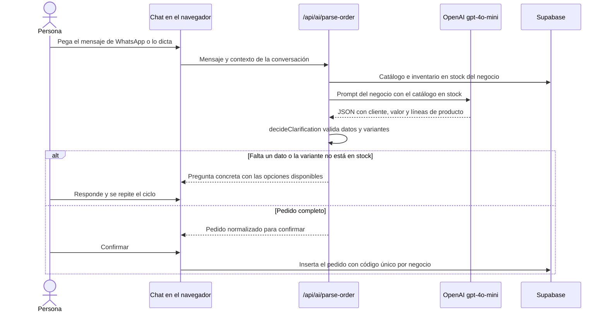

El monto se normaliza en el servidor (no se confía en el número que devuelve el modelo), y si la respuesta del modelo llega cortada o no es JSON válido, el usuario recibe un mensaje en lugar de un error.

### Gate de validación

`npm run validate` ([`scripts/validate.mjs`](scripts/validate.mjs)) es la verificación previa al despliegue: `tsc`, ESLint, pruebas unitarias, estructura de las migraciones, políticas de seguridad (RLS declarada, sin llaves embebidas en el código, `AUTH_SECRET` documentada), que las rutas API usen el cliente acotado al tenant y, de forma opcional, las pruebas E2E (`--e2e`). Si algo falla, termina con código distinto de 0.

---

## Stack

| Capa | Tecnología |
|---|---|
| Frontend | Next.js 16 (App Router, Turbopack), React 19, TypeScript 5 |
| Estilos | Tailwind CSS 4, íconos `lucide-react`, manifest PWA |
| Datos | Supabase: PostgreSQL + PostgREST + RLS (`@supabase/supabase-js`) |
| IA | OpenAI `gpt-4o-mini` (texto e imagen) con respuestas en JSON |
| Voz | Web Speech API del navegador (`es-CO`) |
| Autenticación | JWT propio con `jose` + `bcryptjs` |
| Gráficas | Recharts |
| Excel y QR | `exceljs`, `qrcode` |
| Pagos | Stripe (suscripciones, opcional) |
| Pruebas | Vitest + happy-dom (unitarias), Playwright (E2E) |
| Despliegue | Vercel + Vercel Cron |

---

## Correr en local

### Requisitos

- Node.js **22** (el repositorio trae `.nvmrc` con la versión 22 y `engines` fija `22.x`, la misma que usa la CI; Vercel ya no admite Node 20).
- Un proyecto de [Supabase](https://supabase.com) (sirve el plan gratuito).
- Opcional: una API key de [OpenAI](https://platform.openai.com) para las funciones de IA.

### 1. Instalar

```bash
git clone https://github.com/ronalc90/koptup-comercio-electronico.git
cd koptup-comercio-electronico
npm ci
```

### 2. Variables de entorno

```bash
cp .env.example .env.local
```

Completa `.env.local` (el propio `.env.example` explica cada variable):

| Variable | ¿Obligatoria? | Para qué sirve |
|---|---|---|
| `NEXT_PUBLIC_SUPABASE_URL` | Sí | URL del proyecto de Supabase |
| `NEXT_PUBLIC_SUPABASE_ANON_KEY` | Sí | Llave anónima de Supabase |
| `SUPABASE_SERVICE_ROLE_KEY` | Sí | Operaciones del servidor (login, administración, plataforma, crons). Sin ella, el servidor usa la llave anónima y esas rutas fallan |
| `AUTH_SECRET` | En producción | Firma los JWT de sesión; mínimo 32 caracteres (`openssl rand -hex 32`) |
| `SUPABASE_JWT_SECRET` | Sí, si aplicas la migración 003 | JWT secret del proyecto: el servidor firma con él el token con `tenant_id` que usa el navegador para pasar la RLS estricta |
| `OPENAI_API_KEY` | No | IA global; cada negocio puede poner la suya en Configuración |
| `CRON_SECRET` | No | Autoriza los crons de Vercel |
| `SUPABASE_ACCESS_TOKEN` | No | Solo para aplicar SQL con `npm run db:exec` |
| `STRIPE_SECRET_KEY`, `STRIPE_WEBHOOK_SECRET`, `STRIPE_PRICE_PRO`, `STRIPE_PRICE_ENTERPRISE` | No | Cobro en línea de licencias. Sin ellas, el pago queda desactivado |

> El código también lee `SHIPPING_ENC_KEY` y `SHIPPING_WEBHOOK_SECRET` (integración con transportadora) y `AUTH_STRICT_SECRET` (con `1` o `true`, hace que la app no arranque en producción si `AUTH_SECRET` es débil). Aún no están en `.env.example`; agrégalas si usas esas funciones.

### 3. Base de datos

En el **SQL Editor** de Supabase ejecuta [`supabase-schema.sql`](supabase-schema.sql) y después, **en orden**, los archivos de [`migrations/`](migrations/) (de `002_multi_tenant.sql` a `018_supplier_intake_order_phases_shipping.sql`). Las migraciones están escritas para poder re-ejecutarse sin romper nada. La 003 activa la RLS estricta por negocio: a partir de ella el navegador solo lee datos si `SUPABASE_JWT_SECRET` está configurada. Si prefieres la terminal, con `SUPABASE_ACCESS_TOKEN` en `.env.local`:

```bash
npm run db:exec supabase-schema.sql
npm run db:exec migrations/002_multi_tenant.sql
# … y así hasta la 018
```

Opcionalmente, [`scripts/seed-bodega-demo.sql`](scripts/seed-bodega-demo.sql) crea un negocio de demostración con proveedores, productos, inventario y pedidos.

> **Seguridad:** la migración 002 y el seed de demostración crean usuarios iniciales cuyas contraseñas aparecen en el propio SQL. Cámbialas o desactiva esos usuarios antes de exponer cualquier entorno.

### 4. Arrancar

```bash
npm run dev      # http://localhost:3000
```

Para un build de producción: `npm run build && npm run start`. También hay `Dockerfile` y `docker-compose.yml` que levantan `npm run dev` en un contenedor usando `.env.local`.

### Scripts

| Comando | Qué hace |
|---|---|
| `npm run dev` | Servidor de desarrollo |
| `npm run build` / `npm run start` | Build de producción y servirlo |
| `npm run lint` | ESLint |
| `npm run typecheck` | `tsc --noEmit` |
| `npm test` / `npm run test:watch` | Pruebas unitarias (Vitest) |
| `npm run test:e2e:install` / `npm run test:e2e` | Instalar Chromium para Playwright y correr las E2E |
| `npm run validate` | Gate de validación previo al despliegue |
| `npm run db:exec <archivo.sql>` | Ejecutar SQL en Supabase mediante la Management API |

---

## Pruebas

**Unitarias (Vitest).** Viven junto al código (`*.test.ts`) y cubren la lógica pura: aclaración de pedidos, fases, permisos, planes, facturación, agentes, automatizaciones, cálculos de proveedores, transportadora, JWT de Supabase, registro, rate limit y utilidades. Al momento de escribir esto son **289 pruebas en 26 archivos**, todas en verde.

```bash
npm test
```

**E2E (Playwright).** Smoke de login y redirecciones, navegación autenticada, modales de ayuda, la vista de pedidos, el flujo conversacional de "Pedido IA" (con la ruta de IA simulada) y los reportes de proveedores. Las pruebas autenticadas se omiten si no hay credenciales.

```bash
npm run test:e2e:install   # solo la primera vez
MERAKI_E2E_USER=<usuario> MERAKI_E2E_PASSWORD=<contraseña> npm run test:e2e
# Contra un despliegue ya publicado:
MERAKI_E2E_BASE_URL=https://<tu-deploy>.vercel.app npm run test:e2e
```

Sin `MERAKI_E2E_BASE_URL`, Playwright compila y levanta la app con `npm run build && npm run start`.

---

## Despliegue

El sitio corre en **Vercel**: <https://koptup-comercio-electronico.vercel.app>.

1. Importa el repositorio en Vercel.
2. Define las variables de entorno de la tabla anterior (como mínimo las de Supabase, `SUPABASE_SERVICE_ROLE_KEY` y `AUTH_SECRET`).
3. Aplica el esquema y las migraciones en el proyecto de Supabase de producción.
4. [`vercel.json`](vercel.json) programa dos crons, que se autorizan con `CRON_SECRET`:
   - `/api/cron/run-agents`: todos los días a las 08:00 UTC, ejecuta los agentes y guarda las alertas.
   - `/api/cron/purge-rejected`: todos los días a las 03:00 UTC, borra los registros rechazados hace más de 30 días.
5. Opcional: el webhook de Stripe apunta a `/api/billing/webhook` ([guía](docs/STRIPE_SETUP.md)) y el de la transportadora a `/api/shipping/webhook`.

---

## Estado del proyecto

- **En producción.** La versión visible es la **1.058** (el historial de cambios se lee en Configuración → Acerca de); `main` suma más de 130 commits entre abril y julio de 2026.
- Verificado para este README: el build de producción, `tsc`, ESLint y las 289 pruebas unitarias pasan, y las pantallas de las capturas funcionan contra una base local con todas las migraciones aplicadas.
- **Pendientes conocidos:**
  - El cobro en línea con Stripe está implementado pero desactivado hasta configurar la pasarela; mientras tanto, las licencias las gestiona el superadmin.
  - `npm run validate` marca hoy un fallo en el chequeo 6: cuatro rutas recientes (`auth/register`, `orders/phase`, `orders/tracking` y `shipping/webhook`) usan el *service client* con filtro manual por tenant y aún no están en la lista de excepciones del gate.
  - De las 12 pruebas E2E, 10 pasan contra un entorno local. Las otras dos ("Pedido IA" y "Cuentas por pagar") fallan porque el texto que buscan aparece más de una vez en pantalla: hay que acotar esos selectores.
  - La integración real con Interrapidísimo necesita credenciales del negocio; sin ellas se usa el modo *sandbox*.
  - Agentes: el de QA todavía no reconoce las fases "En alistamiento" y "Alistado" (las marca como estado inválido), y el Comercial atribuye ventas por palabras del nombre, así que productos que comparten una palabra (p. ej. "Pantufla …") suman las ventas de todos.
  - En el celular, con ocho o más opciones de menú las etiquetas de la barra inferior se superponen en pantallas de 390 px.
- La hoja de ruta por fases está en [`docs/ROADMAP.md`](docs/ROADMAP.md).

---

## Documentación adicional

- [`docs/ARCHITECTURE_MULTITENANT.md`](docs/ARCHITECTURE_MULTITENANT.md): arquitectura multi-tenant, modelo de amenaza y ruta de endurecimiento.
- [`docs/RUNBOOK_HARDENING.md`](docs/RUNBOOK_HARDENING.md): procedimientos de seguridad y tabla de permisos por rol.
- [`docs/STRIPE_SETUP.md`](docs/STRIPE_SETUP.md): cómo configurar los pagos.
- [`docs/ROADMAP.md`](docs/ROADMAP.md): fases del producto.
- [`PROVEEDORES_ENTREGA.md`](PROVEEDORES_ENTREGA.md): diseño y entrega del módulo de proveedores.
- [`AGENTS.md`](AGENTS.md): esta versión de Next.js trae cambios importantes; antes de programar, consulta `node_modules/next/dist/docs/`.

---

## Autor

**Ronald Cipagauta**

- Sitio: <https://www.koptup.com>
- GitHub: [@ronalc90](https://github.com/ronalc90)
